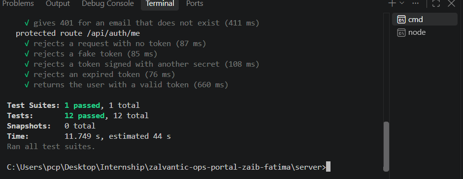

# Internship Operations Portal

This is the project I'm building during my MERN stack internship at Zalvantic. The idea is a portal that runs a remote internship: cohorts, weekly tasks, reviews and certificates that anyone can verify.

I'm building it one week at a time, so right now only the first part exists: the project setup and the login system.

## Where the project is

| Week | What gets built | Finish by | Status |
| ---- | --------------- | --------- | ------ |
| 1 | Set up the project and log in | 08/11/2026 | Done |
| 2 | Roles and the first real data | 15/11/2026 | Not started |
| 3 | Cohorts, domains and CSV import | 22/11/2026 | Not started |
| 4 | Weekly tasks and submissions | 29/11/2026 | Not started |
| 5 | Reviews and feedback | 06/12/2026 | Not started |
| 6 | Certificates and verification | 13/12/2026 | Not started |
| 7 | Automation, emails and security | 20/12/2026 | Not started |
| 8 | Tests, Docker and deployment | 27/12/2026 | Not started |

## What's in week 1

- A server with register, login and one protected route (`/api/auth/me`).
- A client with a login page and a small dashboard that only works when you're logged in.
- 12 tests that check the register and login flow and that the protected route rejects missing, fake, wrong-secret and expired tokens.

## Tech used

Node.js, Express, MongoDB (Atlas) with Mongoose, TypeScript, Zod, JWT, bcrypt, helmet, cors, React with Vite, Jest and Supertest.

## Folder structure

```
server/
  src/
    models/        User model
    controllers/   register, login, me
    routes/        /api/auth routes
    middleware/    requireAuth (checks the token)
    services/      token helpers (sign and verify)
    app.ts         builds the express app
    server.ts      connects to MongoDB and starts the server
  tests/           auth tests
client/
  src/
    api/           calls to the server
    pages/         login and dashboard pages
    components/    ProtectedRoute
    routes.tsx
docs/              diagrams and screenshots
.env.example
```

## How to run it

You need Node 20 or newer and a MongoDB database. I used a free Atlas cluster.

1. Clone the repo and open it:
   ```bash
   git clone https://github.com/Zaib058/zalvantic-ops-portal-zaib-fatima.git
   cd zalvantic-ops-portal-zaib-fatima
   ```

2. Make your own `.env` file in the root folder (next to `.env.example`) and fill it in:
   ```
   PORT=5000
   MONGO_URI=your atlas connection string, ending in /ops-portal
   JWT_SECRET=a long random string
   MONGO_URI_TEST=same string but ending in /ops-portal-test
   CLIENT_URL=http://localhost:5173
   ```
   You can make a secret with:
   ```bash
   node -e "console.log(require('crypto').randomBytes(48).toString('hex'))"
   ```
   The `.env` file is ignored by Git, so it never gets pushed.

3. Start the backend:
   ```bash
   cd server
   npm install
   npm run dev
   ```
   It should print `mongodb connected` and `server running on port 5000`.

4. In a second terminal, start the frontend:
   ```bash
   cd client
   npm install
   npm run dev
   ```
   Then open http://localhost:5173.

5. There is no register page yet, so make a user first with Postman or Thunder Client. Send a `POST` to `http://localhost:5000/api/auth/register` with this JSON body:
   ```json
   {
     "name": "Test User",
     "email": "test@example.com",
     "password": "password123"
   }
   ```
   After that you can log in on the login page.

## How to run the tests

```bash
cd server
npm test
```

The tests use the second database from `MONGO_URI_TEST`. It has to be a different database from the real one, because the tests delete all users after each test.



## API

| Method | Route | Needs a token | What it does |
| ------ | ----- | ------------- | ------------ |
| GET | `/api/health` | no | checks that the server is running |
| POST | `/api/auth/register` | no | creates a user (name, email, password) |
| POST | `/api/auth/login` | no | returns an access token and the user |
| GET | `/api/auth/me` | yes | returns the logged in user |

Protected routes expect the header `Authorization: Bearer <token>`.

## How it works

These diagrams explain each part in a bit more detail.

### Setup and structure


The folders follow the structure from the brief. `app.ts` only builds the express app and `server.ts` is the one that starts it. I kept them apart so the tests can use the app without opening a real port.

### Data and register


Secrets stay in `.env` and only `.env.example` goes to GitHub. The user model has name, email and passwordHash. When someone registers, Zod checks the input first, then the email is checked for duplicates, and the password is hashed with bcrypt before saving. The real password is never stored and the hash is never sent back.

### Login, the protected route and the tests


Login compares the typed password with the stored hash and returns a token that lasts 15 minutes. A wrong email and a wrong password give the same error on purpose. The `requireAuth` middleware reads the `Bearer` token, checks the signature and the expiry, and only then lets the request reach the controller.

### Client, security and lessons


## Trying it by hand

This is how I checked that the protected route really works from the browser.

**1. Login page**


**2. After logging in, the dashboard calls `/api/auth/me` and shows my name**


**3. The token is saved in local storage (I blurred the value)**


**4. I replaced the token with a fake one from the console**


**5. After a refresh the server answers 401, the token is cleared and I'm sent back to the login page**


## Things I know are not perfect yet

- The token is stored in `localStorage`. Scripts injected into the page could read it, so httpOnly cookies would be safer.
- There are only access tokens that expire after 15 minutes. Refresh tokens are planned for a later week.
- There is no register page on the client yet.
- There are no roles yet. That comes in week 2.

## Learning log

**Week 1**

- Git: my first `git push` failed with "No configured push destination". My folder wasn't connected to the GitHub repo, so I cloned the repo again and copied my files in.
- Windows: `Invoke-RestMethod` doesn't work in cmd, only in PowerShell, so I used curl and later Thunder Client.
- The server didn't start at first, and curl said "failed to connect". I had forgotten to run `npm run dev` before testing.
- Tests: the tests with `mongodb-memory-server` timed out on my laptop, because it couldn't start a temporary database. I switched to a second database on Atlas just for tests, and then all 12 passed.
- Secrets: I pasted a connection string with my password in a chat by mistake, so I changed the password straight away. Now I check `git status` before every commit to make sure `.env` isn't in it.
- Still unclear: I'm still a bit confused about how the tests run in the terminal, mainly how Jest and Supertest work together.

## Resources I used

- Git and GitHub: the Git and GitHub course by Shradha Khapra on the Apna College YouTube channel.
- Express, JWT and bcrypt: DEV Community articles and the MDN Express tutorial.
- Claude, to explain steps I didn't understand and to help with errors.

## Pull requests

- Week 1: [Week 1: Set up the project and log in]https://github.com/Zaib058/zalvantic-ops-portal-zaib-fatima/pull/1

---

Built as part of the Zalvantic Internship Programme.
